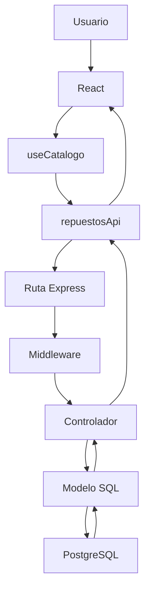
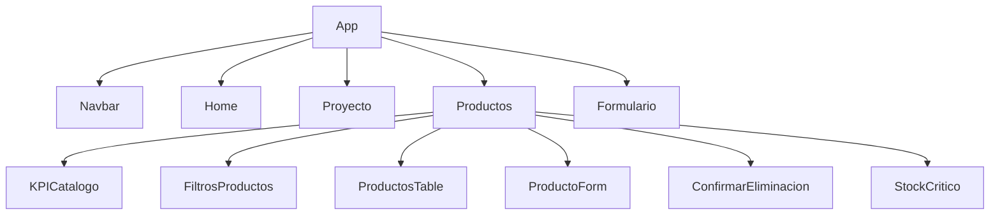

# Arquitectura — Repuestos Pérez

Hay una sola aplicación. La carpeta antigua en HTML ya no forma parte de la entrega.

## Flujo de un repuesto

Ejemplo de un alta:

1. `ProductoForm` valida en el navegador con `validarRepuesto`.
2. `Productos` llama a `crear` del hook `useCatalogo`.
3. `frontend/src/services/repuestosApi.js` hace `POST /api/repuestos` con Axios.
4. Vite, en desarrollo, envía `/api` a `http://localhost:3000`.
5. `backend/src/routes/repuestos.routes.js` recibe el POST.
6. `validarRepuesto` rechaza datos inválidos con 400.
7. `repuestos.controller.js` llama a `crearRepuesto`.
8. `repuestos.model.js` ejecuta un `INSERT` con `$1` … `$7`.
9. Si el código ya existe, PostgreSQL devuelve `23505` y `errorHandler` responde 409.
10. React agrega el registro a la lista. Al recargar, `GET /api/repuestos` lo vuelve a traer.

## Componentes de la interfaz

Los filtros se aplican en el navegador sobre la lista que ya trajo el GET. El catálogo de demostración es corto y no hace falta filtrar en SQL.

## Dónde está cada pieza

| Pieza | Archivo |
| --- | --- |
| Montaje de React | `frontend/src/main.jsx` |
| Rutas de pantalla | `frontend/src/App.jsx` |
| Catálogo | `frontend/src/pages/Productos.jsx` |
| Hook del inventario | `frontend/src/hooks/useCatalogo.js` |
| Axios | `frontend/src/services/api.js` y `repuestosApi.js` |
| Proxy | `frontend/vite.config.js` |
| App Express | `backend/src/app.js` |
| Arranque | `backend/src/server.js` |
| Rutas REST | `backend/src/routes/repuestos.routes.js` |
| Middlewares | `backend/src/middlewares/` |
| Controlador | `backend/src/controllers/repuestos.controller.js` |
| SQL | `backend/src/models/repuestos.model.js` |
| Conexión | `backend/src/config/database.js` |
| Tablas | `database/schema.sql` |

## Tres validaciones

- React: el formulario no se envía si el precio es negativo, el stock no es entero o el código está vacío.
- Express: el middleware vuelve a revisar el cuerpo. No se confía en el navegador.
- PostgreSQL: `CHECK` de precio y stock, textos no vacíos, `codigo` único y un índice por `upper(codigo)` para que `abc` y `ABC` no convivan.

El código se guarda al crear y el `UPDATE` no lo modifica.
