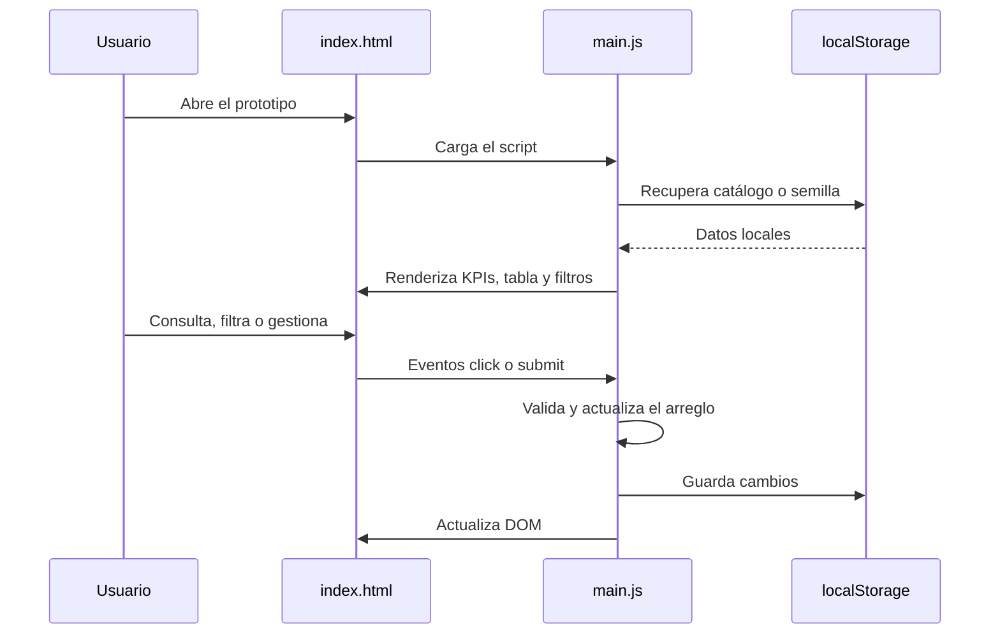
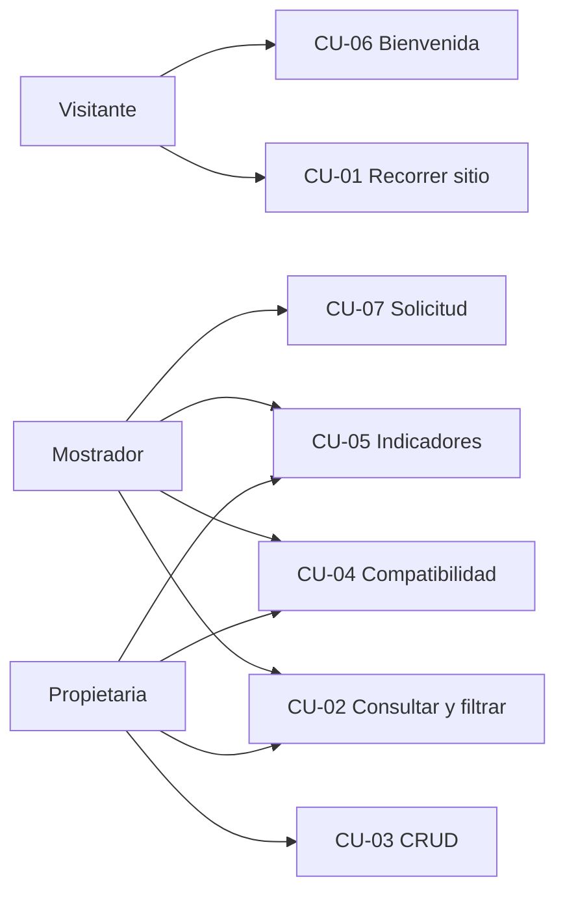

# Proyecto Pedagógico Integrador — Repuestos Pérez

**Sistema web para la gestión de inventario y consulta de repuestos para motocarros**

| Campo | Valor |
|-------|--------|
| Institución | Tecnológico de Antioquia Institución Universitaria |
| Programa | Técnico Profesional en Sistemas |
| Facultad / área | Facultad de Ingeniería · Área Informática |
| Asignatura | Construcción de Software III — PRESIMIG15124 |
| Docente | Cristian Lopera |
| Grupo / sede | PREESP26020020006-002 · Medellín |
| Versión | 1.1 (25/08/2026) |
| Entrega | Puntos 1 a 3 (contexto, análisis e interacción) y 4.6 (prototipo) |

**Elaborado por**

- Daniel Bermúdez Pérez · CC 1152693187
- Sheril Daniela Silva Garcia · CC 1216721707
- Juan Camilo Cabrera Roa · CC 1005859761

Este archivo alinea la documentación del repositorio con el informe `PPI_Repuestos_Perez_Cuarto_Semestre_Actualizado_v1.1.docx`. El prototipo está en `proyecto/index.html`.

---

## Registro de actualizaciones

| Fecha | Versión | Descripción | Autor |
|-------|---------|-------------|--------|
| 24/08/2026 | 1.0 | Versión inicial con los puntos 1 a 3 y 4.6. | Equipo PPI |
| 25/08/2026 | 1.1 | Actualización según el prototipo: inventario con localStorage, CRUD, filtros, compatibilidad, indicadores de stock y solicitud de repuestos. | Equipo PPI |

---

## Introducción

El Proyecto Pedagógico Integrador **Repuestos Pérez** propone un sistema web académico para apoyar la gestión de una **tienda de repuestos para motocarros** en Remedios, Antioquia. Busca centralizar catálogo e inventario, agilizar la consulta de piezas y organizar su compatibilidad con modelos de motocarro, reduciendo registros manuales o herramientas aisladas.

El prototipo actual (HTML, CSS y JavaScript) incluye navegación adaptable, indicadores de inventario, alertas de stock crítico, consulta y filtros, compatibilidad por modelo, agregar/editar/eliminar, persistencia en `localStorage` y un formulario de solicitud de repuestos. Se ejecuta solo en el navegador: **no hay backend, API ni base de datos de servidor**.

---

## 1. Contexto del software web

### 1.1. Descripción del problema

En Repuestos Pérez el inventario y las consultas se han hecho de forma manual o con herramientas no integradas. Eso genera desorganización, errores, búsquedas lentas y poca trazabilidad del stock. También dificulta ver piezas agotadas o con pocas unidades y comprobar si un repuesto es compatible con un modelo de motocarro. El personal tarda más en atender y el riesgo de trabajar con información dispersa aumenta.

### 1.2. Descripción del negocio

Repuestos Pérez es una tienda dedicada **exclusivamente** a la venta de repuestos para motocarros en Remedios, Antioquia. La propietaria, **Dioni Pérez Jimenez**, administra la información; el personal de mostrador consulta disponibilidad para conductores, propietarios y talleres de motocarros. El proyecto **no contempla servicios de taller ni reparación**.

### 1.3. Área a intervenir

Gestión de inventario y consulta de repuestos en el punto de venta: código, nombre, categoría, marca, precio, stock y compatibilidad. El prototipo añade indicadores, alertas de stock crítico y registro local de solicitudes en el mostrador.

Flujo del proceso: **registro o actualización del repuesto → catálogo centralizado → consulta y filtros → disponibilidad y compatibilidad → atención de la solicitud**.

### 1.4. Justificación

Un sistema web centralizado facilita la consulta, reduce errores de registros manuales y mejora la trazabilidad. Los indicadores y el stock crítico ayudan a ver faltantes; la compatibilidad por modelo reduce recomendaciones incorrectas. Académicamente permite aplicar análisis, requisitos, interacción y desarrollo web sobre un caso real.

### 1.5. Objetivos

**Objetivo general:** desarrollar un sistema web que permita consultar, registrar, actualizar y organizar repuestos para motocarros, con una interfaz clara para el personal de Repuestos Pérez.

**Objetivos específicos:**

1. Centralizar catálogo e inventario (código, nombre, categoría, marca, precio, stock y compatibilidad).
2. Facilitar búsqueda por código o nombre y filtros por marca, categoría, disponibilidad y modelo.
3. Permitir agregar, editar y eliminar, conservando cambios en el almacenamiento local del navegador.
4. Mostrar indicadores de inventario, estados de disponibilidad y listado de stock crítico.
5. Diseñar una interfaz adaptable con navegación, eventos, DOM, validación de formularios y registro local de solicitudes.

### 1.6. Alcance

Incluye: página funcional en el navegador; menú adaptable; catálogo; consulta y filtros; tabla con código, nombre, categoría, marca, precio, compatibilidad, stock y estado; KPIs; stock crítico; CRUD local; `localStorage`; bienvenida dinámica; formulario de solicitud validado.

No incluye: autenticación real, operación multiusuario, backend, API, base de datos de servidor, envío de correos ni procesamiento de transacciones.

### 1.7. Necesidades

Organización: **Repuestos Pérez**. Proceso: **gestión de inventario, consulta y solicitud de repuestos**. Stakeholder principal: **Dioni Pérez Jimenez** (propietaria / administradora).

| ID | Descripción | Prioridad | Fecha |
|----|-------------|-----------|--------|
| NU-01 | Centralizar el catálogo y el inventario de repuestos. | Alta | 24/08/2026 |
| NU-02 | Agilizar la consulta mediante búsqueda y filtros. | Alta | 24/08/2026 |
| NU-03 | Organizar la compatibilidad entre repuestos y modelos. | Alta | 24/08/2026 |
| NU-04 | Disponer de una interfaz web clara y adaptable. | Media | 24/08/2026 |
| NU-05 | Identificar disponibilidad, stock bajo, agotados y stock crítico. | Alta | 24/08/2026 |
| NU-06 | Registrar en el mostrador solicitudes de clientes. | Media | 25/08/2026 |

---

## 2. Documentación del análisis

Las operaciones se ejecutan en el navegador. Cuando aplica, `localStorage` es persistencia local de demostración.

### 2.1. Requisitos funcionales

| Código | Nombre | Necesidad | Prioridad | Descripción breve |
|--------|--------|-----------|-----------|-------------------|
| RF-01 | Navegar por las secciones | NU-04 | Media | Recorrer Inicio, Sobre el proyecto, Funcionalidades, Catálogo y Solicitud. Menú hamburguesa; cierre con enlace o Escape. |
| RF-02 | Consultar catálogo | NU-02 | Alta | Tabla dinámica: código, repuesto, categoría, marca, precio, compatibilidad, stock, estado y acciones. |
| RF-03 | Generar bienvenida dinámica | NU-04 | Baja | Mensaje `Bienvenido, [nombre]. Gracias por visitar nuestro sistema.` |
| RF-04 | Registrar solicitud de repuesto | NU-06 | Media | Validar cliente, teléfono opcional, correo, repuesto y observaciones. Confirmación local, sin servidor. |
| RF-05 | Gestionar repuestos (CRUD) | NU-01 | Alta | Agregar, editar y eliminar con validación de código/nombre y confirmación de borrado. |
| RF-06 | Filtrar repuestos | NU-02 | Alta | Código/nombre, marca, categoría, disponibilidad y modelo, combinables. |
| RF-07 | Consultar compatibilidad | NU-03 | Alta | Modelos de demostración: Bajaj RE, Piaggio Ape, TVS King, Motocarro 200. |
| RF-08 | Persistir catálogo localmente | NU-01 | Media | Clave `repuestos-perez-catalogo`. Si no hay datos válidos, se carga el catálogo inicial. |
| RF-09 | Indicadores y alertas de stock | NU-05 | Alta | Disponible (> 5), stock bajo (1–5), agotado (0). Stock crítico: agotados o ≤ 5. |

### 2.2. Requisitos no funcionales

| Código | Nombre | Prioridad | Descripción breve |
|--------|--------|-----------|-------------------|
| RNF-01 | Diseño adaptable y navegación accesible | Alta | Escritorio y móvil; skip-link, ARIA, Escape. |
| RNF-02 | Compatibilidad de navegador | Media | Chrome, Edge o Firefox; HTML5, CSS, JS y localStorage, sin Node ni servidor. |
| RNF-03 | Separación de presentación y lógica | Media | `index.html`, `css/styles.css`, `js/main.js`. Sin CSS en línea. |
| RNF-04 | Ejecución local del prototipo | Media | Sin backend. Un solo navegador de demostración. |

---

## 3. Interacción del sistema web

La interacción ocurre en el navegador: recorrer, consultar, filtrar, revisar compatibilidad y stock, gestionar repuestos, bienvenida y solicitudes. JavaScript procesa eventos, actualiza el DOM y guarda el catálogo en `localStorage`.

### 3.1. Diagrama de secuencia (consulta y persistencia)

Los marcadores t0–t9 indican el orden lógico de la plantilla; no son tiempos medidos. No hay backend, así que no hay concurrencia cliente-servidor.



### 3.2. Casos de uso

Actores: visitante/cliente, propietaria/administradora y personal de mostrador.



#### CU-01 · Recorrer el sitio (RF-01)

**Iniciador:** visitante / cliente. **Precondición:** `index.html` abierto.

Flujo: ingresa → el sistema muestra secciones → elige Inicio, Sobre el proyecto, Funcionalidades, Catálogo o Solicitud → la vista se desplaza. En móvil abre el menú hamburguesa; puede cerrarlo con Escape. Los botones del hero van a Catálogo y Sobre el proyecto.

#### CU-02 · Consultar y filtrar catálogo (RF-02 / RF-06)

**Iniciador:** propietaria o mostrador.

Flujo: escribe código/nombre y/o elige marca, categoría, disponibilidad o modelo → pulsa Consultar → el sistema filtra y pinta la tabla. Si no hay coincidencias: *No se encontraron repuestos con esos filtros.* **Ver catálogo** limpia filtros. Extensión: Editar y Eliminar por fila.

#### CU-03 · Gestionar repuestos — CRUD (RF-05 / RF-08)

**Iniciador:** propietaria. **Otro actor:** mostrador.

Flujo: Agregar o Editar → completa datos → Guardar (valida código ≥ 3, nombre ≥ 3, código único en altas) → actualiza arreglo, `localStorage`, tabla e indicadores. Eliminar pide confirmación. Cancelar cierra sin guardar.

#### CU-04 · Compatibilidad por modelo (RF-07)

Selecciona un modelo → solo se listan piezas compatibles. *Todos los modelos* restaura el catálogo. Al editar, los modelos se indican separados por coma.

#### CU-05 · Indicadores y stock crítico (RF-09)

Al entrar a Catálogo (o tras un CRUD) se calculan total, disponibles, stock bajo y agotados, y la lista crítica. Si no hay críticas: *No hay piezas en stock crítico.*

#### CU-06 · Recibir bienvenida (RF-03)

**Iniciador:** visitante. Escribe nombre → Mostrar bienvenida → `Bienvenido, [nombre]. Gracias por visitar nuestro sistema.` Si está vacío: *Ingrese su nombre para generar el saludo.* No se almacenan datos.

#### CU-07 · Registrar solicitud de repuesto (RF-04)

**Iniciador:** mostrador. **Otro actor:** cliente.

Flujo: nombre, teléfono opcional, correo, repuesto y observaciones → Enviar solicitud → validación por campo. Teléfono, si se diligencia, 7 a 10 dígitos. Confirmación local; no hay envío a servidor.

---

## 4. Diseño del sistema web

### 4.6. Prototipo

Página única que se abre con `proyecto/index.html` (HTML, CSS y JavaScript). No requiere Node, Java ni servidor. Esta iteración incluye CRUD local, filtros, compatibilidad, indicadores, `localStorage` y solicitud validada.

```
proyecto/
├── index.html
├── css/styles.css
├── js/main.js
├── assets/imagenes/
└── evidencias/
```

**Cómo abrirlo:** carpeta `proyecto` → `index.html` en Chrome, Edge o Firefox. Comprobar navegación, menú móvil, filtros, compatibilidad, indicadores, CRUD, persistencia y formulario.

**Límites:** sin login real, backend, API ni BD de servidor. El catálogo de demostración se guarda solo en `localStorage`. La solicitud no se envía por correo.

| Control | Evidencia en el prototipo |
|---------|---------------------------|
| CSS externo | `css/styles.css`, sin estilos en línea |
| Diseño adaptable | Menú hamburguesa y columnas apiladas |
| Navegación accesible | Skip-link, ARIA, Escape |
| Dashboard | KPIs y stock crítico |
| Consulta y filtros | Código/nombre, marca, categoría, disponibilidad, modelo |
| Compatibilidad | Selector de modelo |
| CRUD | Alta, edición y eliminación |
| Persistencia | `localStorage` · clave `repuestos-perez-catalogo` |
| Bienvenida | Click, variables y DOM |
| Solicitud | `submit`, `preventDefault` y validación por campo |

**Evidencias visuales** (carpeta `proyecto/evidencias/`):

| Figura | Archivo | Contenido |
|--------|---------|-----------|
| 3 | `01-hero.png` | Página principal e identidad visual |
| 4 | `02-hover-boton.png` | Hover de botones |
| 5 | `03-problema.png` | Problema, público y necesidad |
| 6 | `04-funcionalidades.png` | Inventario, filtros, compatibilidad y alertas |
| 7 | `05-dashboard.png` | Indicadores y stock crítico |
| 8 | `06-compatibilidad.png` | Compatibilidad por modelo |
| 9 | `07-catalogo.png` | Tabla con acciones |
| 10 | `08-crud.png` | Formulario agregar/editar |
| 11 | `09-menu-movil.png` | Menú en celular |
| 12 | `10-solicitud.png` | Bienvenida y validación |
| 13 | `11-footer.png` | Integrantes del equipo |
